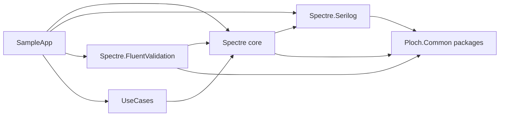

# Architecture — ploch-commandline

| Field | Value |
|---|---|
| Last verified | 2026-10-13, against commit `6fdfc2d` (service lifetimes, PLO-781) |
| Verified by | Reading every project file and source file under `src/`; spot checks by `grep` |
| Index | [`CLAUDE.md`](../../CLAUDE.md) |

Paths below are relative to the repository root. `core/` abbreviates
`src/Spectre/CommandLine.Spectre/`.

## 1. Summary

A thin, opinionated façade over the .NET Generic Host and Spectre.Console.Cli. There are no
architectural layers inside the packages; the structure is a builder, two template-method command
base classes, an output pipeline, and dependency-injection modules ("services bundles") from
`Ploch.Common.DependencyInjection`.

The library has no database, no web surface and no user interface beyond the console.

## 2. Component map

| Project | Package | Purpose |
|---|---|---|
| `core/` | `Ploch.CommandLine.Spectre` | `AppBuilder`, command bases, output pipeline, DI bridge |
| `src/Spectre/CommandLine.Spectre.Serilog/` | `Ploch.CommandLine.Spectre.Serilog` | Serilog defaults and bundle |
| `src/Spectre/CommandLine.Spectre.FluentValidation/` | `Ploch.CommandLine.Spectre.FluentValidation` | Settings validator |
| `src/Spectre/CommandLine.UseCases/` | `Ploch.CommandLine.UseCases` | Use-case commands on `Ardalis.Result` |
| `tests/Spectre/*.Tests/` | not packed | One test project per source project |
| `samples/SampleApp/` | not packed | Showcase CLI and its tests; separate solution |

The arrow from core to Serilog is real: `core/Ploch.CommandLine.Spectre.csproj` has a
`ProjectReference` to the Serilog project, so the Serilog package is a mandatory dependency of the
core package, not an optional add-on.

There is **no Autofac package**. A caller who wants another container uses
`ConfigureHost(h => h.UseServiceProviderFactory(...))`.

The main solution `Ploch.CommandLine.Spectre.slnx` holds the four source and four test projects.
The sample has its own `samples/SampleApp/Ploch.CommandLine.Spectre.SampleApp.slnx`.

## 3. Key types

### 3.1 Core — `Ploch.CommandLine.Spectre`

| Type | File | Role |
|---|---|---|
| `AppBuilder` | `core/AppBuilder.cs` | Fluent builder; owns the cancellation source and Ctrl+C handler |
| `ICommandAppExecutor`, `CommandAppExecutor` | `core/CommandAppExecutor.cs` | `Run` / `RunAsync` over Spectre's `CommandApp` |
| `ConsoleAppInfo` | `core/ConsoleAppInfo.cs` | Name, version, description, banner colours |
| `EnvironmentSettings` | `core/EnvironmentSettings.cs` | Static developer-runtime switches from environment variables |
| `DependencyInjectionTypeRegistrar`, `...TypeResolver` | `core/DependencyInjection/` | Bridge from Spectre's registrar to the host's container |
| `AppServicesBundle`, `OutputServicesBundle` | `core/Configuration/` | Default service registrations |

`AppBuilder` members: `Create(args)`, `WithName`, `WithVersion`, `WithDescription`,
`ConfigureServices` (two overloads), `ConfigureAppConfiguration` (two overloads), `ConfigureHost`,
`AddServicesBundle<T>()`, `ConfigureCommandApp(configurator)`, `Dispose()`.

### 3.2 Core — `Ploch.CommandLine.Spectre.Commands`

| Type | Role |
|---|---|
| `AppCommand<TSettings>`, `AsyncAppCommand<TSettings>` | Base classes; implement `DoExecute` / `DoExecuteAsync` |
| `ExitCode` | `Success` 0, `Error` 1, `InvalidInput` 2, `Cancelled` 130 |
| `IExceptionHandler`, `DefaultExceptionHandler` | Turns an exception into output and an exit code |
| `ICommandSettingsValidator<T>`, `CommandSettingsValidator<T>` | Validation hook; default delegates to `settings.Validate()` |
| `ICommandSettingsProcessor`, `CommandArgumentsRootProcessor` | Settings post-processing pipeline |
| `TokensArgumentsProcessor`, `[SupportsTokens]` | Replaces `{date}` and `{datetime}` in marked string properties |

### 3.3 Core — `Ploch.CommandLine.Spectre.Output`

| Type | Role |
|---|---|
| `IOutput`, `AnsiConsoleMarkupOutput` | Fluent console output used by commands |
| `IMessageFormatterProcessor`, `MessageFormatterProcessor` | Picks a writer or formatter by message type |
| `IMessageWriter<T>`, `IMessageFormatter<T>` and the `TypeMessage*` bases | Extension points for custom types |
| `ServiceCollectionOutputExtensions` | `AddMessageFormatter` / `AddMessageWriter` registration helpers |

### 3.4 Other packages

| Package | Types |
|---|---|
| Serilog | `LoggerConfigurationExtensions.ConfigureSerilog`, `SerilogConfigurationBundle`, `SerilogLoggingConfigurator.AddSerilog` |
| FluentValidation | `CommandLineFluentValidationServicesBundle`, `AddCommandLineSettingsFluentValidation`, `FluentCommandSettingsValidator<T>` |
| UseCases | `IUseCase<TRequest,TResponse>`, `IResultUseCase<TRequest,TResponse>`, `UseCaseAsyncCommand<...>` |

## 4. Key flows

### 4.1 Start-up

1. `AppBuilder.Create(args)` creates a `CancellationTokenSource` and subscribes a handler to
   `Console.CancelKeyPress` (`core/AppBuilder.cs`, `Create`).
2. Fluent calls are recorded, not applied. `ConfigureServices`, `ConfigureAppConfiguration` and
   `ConfigureHost` all append to one list, `_hostBuilderOperations`.
3. `ConfigureCommandApp(configurator)`:
   1. validates the application info (a missing name throws) and prints the banner;
   2. calls `Host.CreateDefaultBuilder(args)`;
   3. adds the services bundles as the first services delegate;
   4. replays the recorded operations in call order;
   5. registers the builder's own `CancellationTokenSource` last;
   6. wraps the host builder in `DependencyInjectionTypeRegistrar` and creates `CommandApp`;
   7. returns a `CommandAppExecutor` holding the builder's cancellation token.
4. `executor.Run(args)` hands over to Spectre, which registers its own types, builds the host
   through the registrar, resolves the command, runs it and disposes the resolver, and with it
   the host.
5. The executor permits one execution attempt. An attempt may build the host and
   `IHostBuilder.Build` can only be called once, so a second `Run` or `RunAsync` on the same
   executor throws `InvalidOperationException` before reaching Spectre, whatever the first
   attempt's outcome; another `ConfigureCommandApp` call on the same builder builds a fresh one,
   unless the builder's cancellation source has already been cancelled, in which case that call
   throws `InvalidOperationException` and a rerun starts from a new builder or a fresh source
   (PLO-756).

`args` is passed twice on purpose: to `Create` for host configuration and to `Run` for parsing.
The canonical call site is `samples/SampleApp/src/SampleApp/Program.cs`.

Step 4 builds the host only once parsing has succeeded and a command is being resolved — a parse
failure or `--version` returns before `DependencyInjectionTypeRegistrar.Build` is called — and never
starts it; see **Hosting** in section 5.

### 4.2 Command execution

1. Spectre binds the settings and calls the command's `Validate` override, which delegates to the
   injected `ICommandSettingsValidator<TSettings>`.
2. `Execute` / `ExecuteAsync` (`core/Commands/AppCommand.cs`, `AsyncAppCommand.cs`) then, inside
   one `try`:
   1. writes an "Executing command" banner and "Processing arguments...";
   2. runs `CommandArgumentsRootProcessor.ProcessArguments(settings)`;
   3. calls `DoExecute` / `DoExecuteAsync` and casts the returned `ExitCode` to `int`.
3. `OperationCanceledException` returns 130 only when the token the command received has
   cancellation requested. Any other exception, including an `OperationCanceledException` raised
   while that token is live (an `HttpClient` timeout, a cancelled inner token), goes to
   `IExceptionHandler` (PLO-756).

The synchronous and asynchronous bases behave identically apart from `await`.

### 4.3 How the other packages plug in

| Package | Mechanism |
|---|---|
| Serilog | Always registered: `AppServicesBundle` declares `SerilogConfigurationBundle` as a dependency. Call `services.AddSerilog(configuration, logName:, logPath:)` to customise. `configuration` is optional: without one the bundle skips the base class's null check and registers the predefined sinks (rolling file, warnings-and-above file, Spectre.Console) at the `Information` minimum level |
| FluentValidation | `services.AddCommandLineSettingsFluentValidation(b => b.AddAssembly(...))` registers an open-generic `ICommandSettingsValidator<>` after the default one, so it wins |
| UseCases | Derive from `UseCaseAsyncCommand<...>`, implement `CreateRequest`, register the use case in DI |

## 5. Design rules and invariants

**Call order.** Of two registrations of the same kind, the later call wins, whichever fluent
method made it. The host builder still runs its phases in a fixed order: host configuration,
application configuration, services, container. The full statement is in the XML documentation of
`AppBuilder.ConfigureCommandApp`.

**Configuration precedence**, lowest to highest: `appsettings.json`,
`appsettings.{Environment}.json`, user secrets (Development only), environment variables, command
line, then any source the caller adds through `ConfigureAppConfiguration`. The builder adds nothing
beyond `Host.CreateDefaultBuilder`; re-adding `appsettings.json` would put it above the command
line.

**Cancellation.** The first Ctrl+C cancels cooperatively and prints a message; the second takes
the default path and terminates the process. Commands receive the builder's own token, not one
resolved from the container, and no `ConfigureServices` call can replace the registered source.

**Ownership.** A builder made with `Create` owns its cancellation source and handler and releases
them in `Dispose`. A builder made with the public constructor owns neither.

**Exit codes.** `ExitCode` covers what a command returns. Spectre returns `-1` for parse and
validation failures before a command runs.

**Output and markup.** `IOutput.Write` renders an `IRenderable` through the console and hands every
other message to the registered writers; `StringMessageWriter` writes a `string` verbatim and
`FormattableStringMessageWriter` renders a `FormattableString` as interpolated markup with its holes
escaped and left to `string.Format` (not pre-rendered by the formatters). `Markup` and `MarkupLine`
are the explicit opt-in to parsing. `WriteBold` and `WriteError` escape content before wrapping it in
a tag and rendering it as markup, and do not use the writers. Handler selection is "most derived
type wins; of two handlers for the same type the later registration wins; unrelated types keep the
first registration". Because the bundle registers before caller `ConfigureServices` delegates, a
consumer writer for `string` or `FormattableString` replaces the built-in one.

**Service lifetimes.** `DependencyInjectionTypeRegistrar` registers everything Spectre asks for
through `Register` — commands, settings, type converters, pair deconstructors — as transient, so a
command holds its transient dependencies for its own lifetime rather than the host's; dependency
lifetimes are unchanged, so singleton services stay shared. A command that constructor-injects its own
settings type receives a fresh, unbound instance; the bound settings are the argument Spectre passes to
`Execute`. `RegisterInstance` and `RegisterLazy` are
singletons, which is what
Spectre's contract requires. `CommandArgumentsRootProcessor` and the `ICommandSettingsProcessor` the
library registers (`TokensArgumentsProcessor`) are transient too; a processor a caller registers
keeps the lifetime the caller gives it. The console, `IOutput`, the message formatter processor, the
`ICommandSettingsValidator<>` implementations, the exception handler and the `CancellationTokenSource`
stay singletons; the FluentValidation `IValidator<T>` implementations found by assembly scanning keep
FluentValidation's default scoped lifetime and are resolved in a scope per validation. Spectre's
registrations are queued when the
application runs, after every `ConfigureServices` delegate, and the last registration wins, so a
caller cannot turn a command back into a singleton from `ConfigureServices`.

**Hosting.** The host is built once a run reaches command resolution — a parse failure or
`--version` returns before `DependencyInjectionTypeRegistrar.Build` is called — and the library
never starts it: it exists for dependency injection, configuration and logging, and a CLI command
is the unit of work. `IHost.StartAsync` is not called, so a registered `IHostedService` is neither
started nor stopped by the library, and a host that was built is disposed when the run ends
(PLO-780, pinned by
`AppBuilderTests.ConfigureCommandApp_should_not_start_the_host_so_a_registered_hosted_service_never_runs`).
Starting the host around the command is a possible 1.x feature, tracked as PLO-785.

## 6. Extension points

| To change | Do this |
|---|---|
| Services | `ConfigureServices`, or a bundle through `AddServicesBundle<T>()` |
| Configuration sources | `ConfigureAppConfiguration` |
| Anything on the host | `ConfigureHost` |
| Validation | Register an `ICommandSettingsValidator<>`, or use the FluentValidation package |
| Settings post-processing | Register another `ICommandSettingsProcessor` |
| Exception handling | Register an `IExceptionHandler` |
| Output for a type | `AddMessageWriter` / `AddMessageFormatter` |

## 7. Known gaps and sharp edges

Found during the 2026-10-05 review. None is tracked as its own issue yet; see
[`BACKLOG.md`](BACKLOG.md) section 6.

| Area | Finding |
|---|---|
| Dependencies | Core depends on the Serilog package, so logging to files is on for every consumer |
| Banner | The FIGlet banner and "Executing command" lines are always written to standard output |
| Docs | Several snippets disagree with the API; tracked as PLO-620 |

Resolved since the review: the cancellation catch now checks the supplied token, the three
entry points null-check, and a second `Run` on one executor fails with a clear
`InvalidOperationException` (PLO-756; see sections 4.1 and 4.2).

## 8. Where to look

| Question | Start here |
|---|---|
| How is an application assembled? | `core/AppBuilder.cs`, `samples/SampleApp/src/SampleApp/Program.cs` |
| What is registered by default? | `core/Configuration/AppServicesBundle.cs`, `OutputServicesBundle.cs` |
| How does a command run? | `core/Commands/AppCommand.cs` |
| How is output dispatched? | `core/Output/AnsiConsoleMarkupOutput.cs`, `MessageFormatterProcessor.cs` |
| What are the Serilog defaults? | `src/Spectre/CommandLine.Spectre.Serilog/LoggerConfigurationExtensions.cs` |
| What does ordering guarantee? | `tests/Spectre/CommandLine.Spectre.Tests/AppBuilderTests.cs` |
| How do I test a command? | `samples/SampleApp/tests/SampleApp.Tests/Commands/` |
